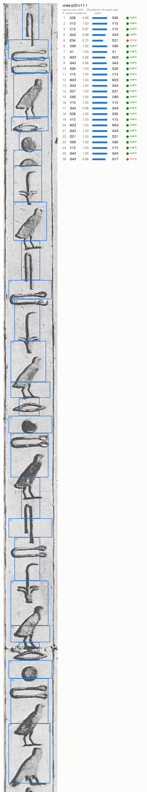
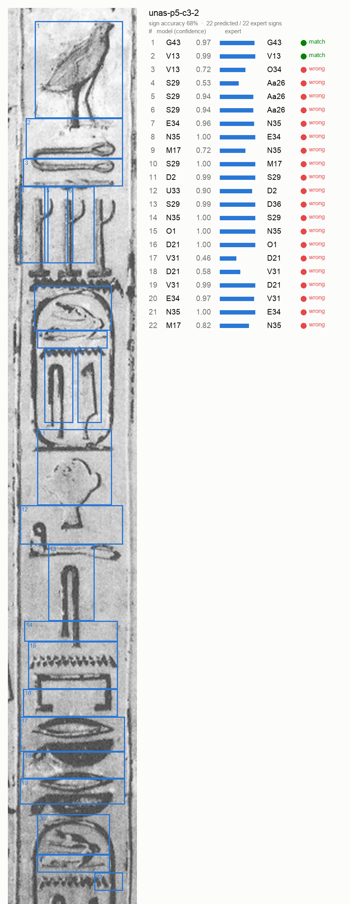

# Reading Hieroglyphs: one fine-tuned open model vs. a frontier model

**One open model (Muse Glimmer 30B + a LoRA we trained today on Fireworks) that reads Egyptian hieroglyphs end to end:**

1. **Photo → signs:** given a photo of a column of hieroglyphs, it lists every sign as its Gardiner code with a bounding box and a per-sign confidence score.
2. **Signs → transliteration:** given the sign codes, it writes the standard Egyptological transliteration.

```
photo ──▶ [same model, call 1] ──▶ O4 168 3 697 64 (0.97)   ──▶ [same model, call 2] ──▶ ḥtp-ḏi̯ nswt …
                                    M17 521 69 773 192 (0.99)
```

## Who benefits and why

Museums, digitization projects and Egyptologists hold vast numbers of photographed but untranscribed inscriptions. Turning a photo into sign codes and a transliteration is slow expert work, and it is the bottleneck between "photo of a wall" and "translation". A small open model that does it cheaply and fast, with confidence scores that flag the signs a human should check, makes bulk digitization affordable. Students learning to read Egyptian benefit from it as a checking tool too.

## Results vs. frontier baseline

Both systems are scored on **the same 330 held-out cases** with **the same scoring code** (`compare.py`).

| System | Photo → codes: sign accuracy ↑ (30 HieroglyphBench columns, 545 signs) | Codes → transliteration: CER ↓ (300 lines, summed) | CER ↓ (per-line, capped at 100%) | Exact match ↑ | Median latency | Cost / 1,000 cases |
|---|---|---|---|---|---|---|
| Kimi K3 (Fireworks, reasoning effort low; text gets 5 solved examples) | 22.5% | 156.9% ¹ | 63.6% | 0.0% | 2.8 s | $5.90 |
| Qwen 3.8 Max (Fireworks, reasoning effort low; text gets 5 solved examples) | 28.0% | 66.1% | 64.4% | 0.0% | 12.9 s | $19.41 |
| **Ours: Muse Glimmer 30B + LoRA** (zero-shot, no examples) | **68.2%** | 81.4% ² | **41.1%** | **5.3%** | n/a ³ | **$0.68** |

_All numbers are measured, not estimated. Raw answers for every case are in `results/` (baselines) and `runs/` (ours). Scored by `compare.py`._

**What improved against the baselines (measured):**
- **Photo → codes:** 68.2% sign accuracy vs. 28.0% for the best baseline (Qwen 3.8 Max), 2.4× higher. Our predicted boxes overlap the expert boxes with a mean IoU of 0.45 on matched signs. Per-sign confidences came back for every case (`raw_logprobs_present: true`, top-5 alternatives included).
- **Codes → transliteration:** exact match 5.3% vs. 0.0%, and per-line capped CER 41.1% vs. 63.6–64.4%. Our model has no examples in its prompt; the baselines get 5.
- **Cost:** $0.68 per 1,000 cases vs. $5.90 (Kimi K3) and $19.41 (Qwen 3.8 Max), 9–29× cheaper.
- **Where we are worse:** summed CER, 81.4% vs. Qwen's 66.1% (see ²).

² **Our main failure:** 6 of the 300 text answers (2%) fell into repetition loops and ran to the 1,024-token cap. They account for 5,347 of our 10,722 character errors; on the other 294 lines our CER is 42.3%. We report the summed number with them included. A stop condition or repetition penalty at inference is the obvious fix, and was not applied to the submitted numbers.

³ Our answers were sampled concurrently inside the Fireworks training session, so per-case latency was not recorded. Our cost uses the Serverless Training sampling rates we were billed ($1.96 / $4.88 per 1M prompt / sampled tokens) on the run's exact token totals (55,712 prompt, 23,361 sampled for all 330 cases). Serving the LoRA in production needs an on-demand deployment billed per GPU-hour, so production cost depends on volume.

¹ One Kimi K3 answer fell into a repetition loop (16,384 tokens of "ḥr ḥr …"), which accounts for 12,244 of its 20,663 character errors. The summed CER keeps it, as the metric is defined. The per-line capped column limits any single line to 100% error and is computed the same way for every system.

**Baseline settings:**
- Both baselines are served on Fireworks serverless inference, called with `temperature=0`, `max_tokens=16384` and `reasoning_effort=low`.
- At default reasoning, Kimi K3 used its whole 8,192-token budget reasoning on a test photo and returned no answer; low effort lets every model answer.
- Prices are Fireworks' published standard per-token rates (input / output per 1M): Kimi K3 $3.00 / $15.00, Qwen 3.8 Max $2.00 / $6.00.
- A closed frontier model (GPT / Claude) run is supported by `frontier_baseline.py` and `fireworks_baseline.py --provider openai`, but was not run because no key was available during the event.

## What the model actually outputs

These are real outputs on unseen HieroglyphBench test photos, drawn from the saved eval answers by `demo_overlay.py`: boxes, codes and per-sign confidence. Errors carry visibly lower confidence. In the best column, the two wrong signs sit at 0.72 and 0.88, while correct signs are mostly at 1.00.

| Best column (92%) | Median column (68%) |
|---|---|
|  |  |

## How we evaluate success

- **Photo → codes:** [HieroglyphBench](https://huggingface.co/datasets/jakeboggs/HieroglyphBench), 30 photographed columns from the Pyramid of Unas (545 signs). Metric is the benchmark's own **sign accuracy**: 1 − (Levenshtein distance over Gardiner codes / number of gold signs), floored at 0, averaged over columns. `vision/hbcommon.py` ports the benchmark's scoring and Gardiner normalisation.
- **Codes → transliteration:** 300 held-out lines from the Thesaurus Linguae Aegyptiae (`data/mix_text_dev.jsonl`). Half are written with layout marks (`D35 -N35 :X1 …`) and half as plain code lists, which is what step 1 outputs. Metrics are **character error rate** (character edit distance / reference length, summed over lines) and exact match, using `bench.py`'s cleaning and normalisation.
- **Separation:** no evaluation case is used for training (see Data).

## Approach

- **Base model:** `accounts/fireworks/models/muse-glimmer-30b`, an open-weight 30B vision-language model on Fireworks.
- **Training:** one LoRA (rank 16) trained with the **Fireworks Serverless Training API** on a single mixed file: 3,326 photo examples + 8,000 transliteration examples, 2.8M tokens, 1 epoch (177 steps), batch 64, learning rate 2e-4. The script is `training/hiero_vision_starter.py`, adapted from Fireworks' `fw-ai/cookbook` starter. Our changes: image + text rows in the same batches, evaluation on fixed eval files, and per-sign confidence from token log-probabilities.
- **Revision note:** the submitted run (`hiero-onemodel-20261102`) used an earlier revision of this script, with sequential training steps and one combined eval file (`data/mix_eval.jsonl` = the 30 photos + the 300 text lines). The committed revision adds pipelined steps (`--max-inflight`) and repeatable `--eval-file`, and is verified to build identical eval prompts. It was not used for the submitted numbers.
- **Confidence:** each sign's confidence is the model's probability of the tokens of its Gardiner code (`exp(sum of token logprobs)`).
- **Cost:** training was $0 under Fireworks' Muse Glimmer promotion. Evaluation sampling is billed at published per-token rates.

## Data

| Set | Size | Source | Licence |
|---|---|---|---|
| Photo training | 1,663 column crops (×2) containing 21,920 labelled sign instances, 156 sign types | GlyphDataset (Franken), from Piankoff's *The Pyramid of Unas* plates | non-commercial, attribution |
| Photo evaluation | 30 columns, 545 signs | HieroglyphBench (same plates) | non-commercial, attribution |
| Text training | 8,000 lines | `bbaw_egyptian` (Thesaurus Linguae Aegyptiae, BBAW) | CC BY-SA 4.0 |
| Text evaluation | 300 lines (+ a separate 300-line final test, `data/test.jsonl`) | same | CC BY-SA 4.0 |

**Leakage control:**
- **Photos:** training crops are cut only from plate regions that do not intersect any HieroglyphBench test crop (`vision/prep_data.py`, `vision/make_vlm_data.py`).
- **Text:** training lines whose sign sequence matches a test line after removing layout marks, or whose transliteration is identical to a test line's, are removed (`dedupe_ft.py`; 161 removed).
- **Text eval:** the 300 text eval lines were held out before training.

## Overfitting and overlap checks

- **Train/test split.**
  - Photo test columns are HieroglyphBench's 30 crops. No training crop intersects them.
  - The 300 text eval lines were held out before training. `data/test.jsonl` (300 lines) was never used.
  - Training ran 1 epoch (photo rows twice), and the final training loss was 0.88.
- **Text overlap we found after the run.**
  - 15 of the 300 eval lines repeat a training line: same sign sequence or identical transliteration, mostly stock formulae. 5 of our 16 exact matches are on those lines.
  - On the 285 clean lines: ours scores exact 3.9%, CER per line 42.0%, CER summed 82.6%. Kimi K3 scores 0.0% / 63.8% / 159.0%, and Qwen 3.8 Max 0.0% / 64.2% / 66.2%.
  - The comparison's conclusions are unchanged. Headline numbers above use all 300 lines.
- **Photo text overlap.**
  - The test photos are unseen, but Pyramid Texts repeat formulae. On average 15% of the 5-sign runs in a test column also occur in some training crop (16 of 30 columns share at least one run).
  - The photo score therefore measures unseen columns of the same monument and style, where context can help, not arbitrary inscriptions.

## Tradeoffs and limitations

- **One photographic style.** Photo training and test both come from the Unas plates, as HieroglyphBench does. Expect lower accuracy on other monuments, papyri or lighting. A multi-style dataset (e.g. Thoth-Sphinx, CC BY-NC) is the next step.
- **Small photo test set.** 30 columns / 545 signs; differences of a few points may not be significant.
- **Rare signs.** About half of the 156 trained sign types have fewer than 5 examples, and 8 test signs belong to types never seen in training.
- **Transliteration conventions vary** between Egyptologists, so CER penalises some valid alternatives.
- **No end-to-end ground truth.** No photo in the data comes with an aligned expert transliteration, so photo → transliteration is demonstrated, not scored.
- **Serving.** The fine-tuned LoRA is not available on Fireworks serverless inference; production use needs an on-demand deployment (billed per GPU-hour). Our latency figures come from in-session sampling.

## Repository layout

| Path | What it is |
|---|---|
| `training/hiero_vision_starter.py` | Fine-tuning script (Fireworks Serverless Training API): mixed image + text LoRA SFT, in-session eval, per-sign confidence |
| `make_mix.py` | Builds the single mixed training file and the 300-line text eval set |
| `vision/make_vlm_data.py` | Cuts column photos from the plates (outside every test crop) with codes + boxes; builds the 30 HieroglyphBench eval rows |
| `vision/prep_data.py`, `vision/hbcommon.py` | Rebuilds HieroglyphBench's column crops for leakage exclusion; HieroglyphBench scoring + Gardiner normalisation |
| `dedupe_ft.py` | Stricter train/test dedupe for the text data |
| `bench.py` | Text data prep (`prepare`) and the text scoring rules |
| `frontier_baseline.py` | Claude baseline on the same 330 cases |
| `fireworks_baseline.py` | Open-model baselines on Fireworks (and OpenAI with `--provider openai`) on the same 330 cases |
| `compare.py` | One scorer for every system; writes `results/compare.json` |
| `results/` | Raw baseline answers (every case) + `compare.json` |
| `runs/` | Our run's metrics, predictions and summary |
| `vision/classifier.py`, `vision/train.py` | Earlier experiment: a small local ResNet-18 single-sign classifier. Not used in the submitted system. |

## Reproduce

```bash
pip install -r requirements.txt anthropic
source .env    # FIREWORKS_API_KEY=..., ANTHROPIC_API_KEY=...  (never commit .env)

# 1. Data
python bench.py prepare                                    # text splits from bbaw_egyptian
python dedupe_ft.py data/ft_train.jsonl data/ft_train_20k_dedup.jsonl
#    photo data: download GlyphDataset into vision/raw/glyphds and HieroglyphBench into vision/raw/bench
(cd vision && python prep_data.py && python make_vlm_data.py)
python make_mix.py                                         # data/mix_train.jsonl, data/mix_text_dev.jsonl

# 2. Train (Fireworks Serverless Training API; run inside a checkout of github.com/fw-ai/cookbook/training)
cp training/hiero_vision_starter.py <cookbook>/training/examples/sft/
#    data/mix_eval.jsonl = vision/data/vlm_bench.jsonl followed by data/mix_text_dev.jsonl (ids textdev-000..299)
python -m examples.sft.hiero_vision_starter launch --file data/mix_train.jsonl --eval-file data/mix_eval.jsonl \
    --run-id hiero-onemodel --epochs 1 --batch-size 64 --lora-rank 16 --learning-rate 2e-4 --top-logprobs 5

# 3. Frontier baseline on the same cases, then score everything the same way
python frontier_baseline.py --model claude-opus-5-5 --effort medium
python compare.py results/frontier_claude-opus-5-5_medium.jsonl runs/<run-id>/predictions_*.jsonl
```

## Disclosures

- **Built during the event:** all code in this repository (data builders, dedupe, the mixed image + text training script, the baseline and comparison scripts) and the trained model.
- **Third-party:**
  - `training/hiero_vision_starter.py` is derived from Fireworks' `fw-ai/cookbook` (Apache 2.0).
  - HieroglyphBench scoring is ported from JakeBoggs/HieroglyphBench.
  - Datasets: GlyphDataset (Morris Franken; Piankoff 1955 plates), HieroglyphBench (Jake Boggs), Thesaurus Linguae Aegyptiae / BBAW via `bbaw_egyptian`.
- **AI assistance:** code was written with help from an AI coding assistant (Claude Code). Dataset research used Firecrawl.
- **Team:** _add all team members_.
- **Sponsor track:** Fireworks. Uses the Fireworks Serverless Training API (LoRA SFT of Muse Glimmer 30B, including vision rows) and Fireworks in-session sampling for evaluation.
